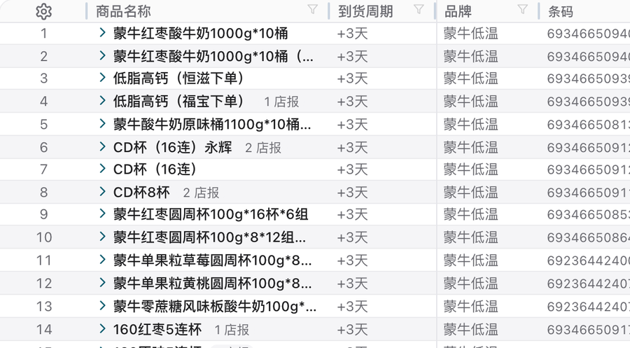
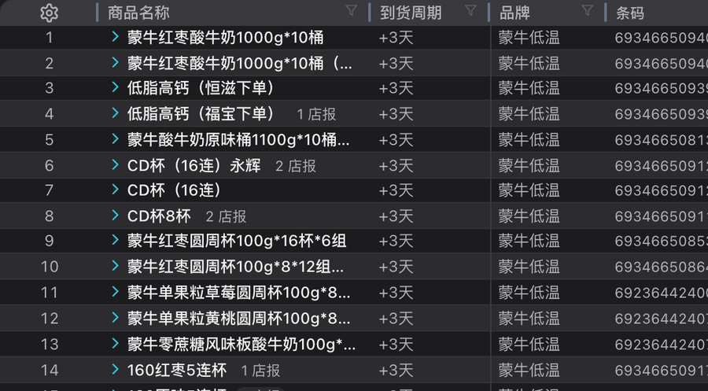

# v738 汇总表前三列「不跟斑马纹走」

日期：2026-11-03　提交：`92b29f6d`　线上：`Forecast-yGJJYUKO.css`（md5 `7db1f3fa…`，本地=服务器=线上逐字节一致）

## 1. 现象

预报订单汇总表里，**序号 / 商品名称 / 到货周期** 三列的行底色始终是纯白，
不跟后面 38 列一起深浅交替。用户原话：
「前面三列没有跟后面的列一样，行与行之间的背景色是深浅交替的」。

## 2. 为什么

不是斑马纹没画上，是**画在了被盖住的地方**。

| 层 | 做了什么 | 结果 |
|---|---|---|
| 斑马纹 | `tr.data-row.zebra{background:var(--bg2)}` | 底色画在 **`<tr>`** 上 |
| 冻结列 | `.frozen` / `.seq-cell` 各写 `background:var(--bg)` | 底色画在 **`<td>`** 上，不透明白 |
| 浏览器 | 子元素背景画在父元素背景**之上** | 白底把斑马纹遮住 |

冻结列这一层白底本身是**必要的**——`position:sticky` 只改绘制位置，
底色不透明才能遮住横向滚过来的内容。所以两条规则各自都对，只有并排量实际颜色才暴露。

同一条根因还压掉了三件事（都一并修了）：

- **hover 在三列内完全无反应** —— 该处 hover 唯一可见变化就是"字色变深"，底被压成同色
- **选中行 / 错误行** 在三列内不上色（只有右侧 38 列变色，像"半条"选中行）
- **改单网格的序号列** 同样脱节（它走 `nth-child(even)`，不是 `.zebra`）

## 3. 实测（改前 / 改后，同一行逐格量 computed backgroundColor）

| | 序号 | 商品名称 | 到货周期 | 品牌（第 4 格起） |
|---|---|---|---|---|
| 改前·浅·斑马行 | `#ffffff` | `#ffffff` | `#ffffff` | `#f5f5f7` |
| 改后·浅·斑马行 | `#f5f5f7` | `#f5f5f7` | `#f5f5f7` | `#f5f5f7` |
| 改前·深·斑马行 | `#1c1c1e` | `#1c1c1e` | `#1c1c1e` | `#2c2c2e` |
| 改后·深·斑马行 | `#2c2c2e` | `#2c2c2e` | `#2c2c2e` | `#2c2c2e` |

普通行改后仍然全白/全深；hover 后全行 `#fafafa`（41 格无一例外）。





## 4. 改法：一个值两处用，而不是两处各写一遍

```css
/* 行状态只描述"这一行是什么底色" */
tr.data-row            { --row-bg:var(--bg) }
tr.data-row.zebra      { background:var(--bg2); --row-bg:var(--bg2) }
tr.data-row:hover      { background:var(--bg3); --row-bg:var(--bg3) }
tr.data-row.selected   { --row-bg:color-mix(in srgb,var(--p) 10%,var(--bg)); background:var(--row-bg) }
tr.data-row.row-error  { background:var(--danger-bg); --row-bg:var(--danger-bg) }
/* 改单网格：nth-child(even) / hover 同样下发 */

/* 冻结列只负责"照着刷"，兜底保证横向滚动时仍不透明 */
.frozen, .seq-cell { background:var(--row-bg,var(--bg)) }
```

两个细节值得记：

- **选中行必须压成实色再下发。** 它原本是 `rgba(6,182,212,.10)`；冻结格刷在 `tr` 底色**之上**，
  同一个半透明色刷两遍会叠成两倍浓度 ⇒ 选中行前三列会比旁边深一档。
  用 `color-mix(in srgb,var(--p) 10%,var(--bg))` 算成实色，`tr` 与冻结格各刷一次但值是同一个。
- **选中行的 `background` 也改成读 `--row-bg`**，不再另写一份 `rgba(...)`。
  两个值写两遍就会漂——这次要的就是一个值两处用。

未来加任何行状态，只要在行规则里多写一行 `--row-bg`，冻结列自动跟上。

## 5. 护栏

`hergent-cn-v2/tests/forecast-sticky-zebra.contract.mjs`，接进 `npm test` 第 ㉔ 组：

1. 冻结列体规则必须写 `var(--row-bg,var(--bg))`（有兜底）
2. 冻结列规则里不许出现写死的 `var(--bg)` / `#fff` / `white`
3. 每条**刷在 `tr` 上**的行底色规则必须同块下发 `--row-bg`
   （`> td` 的规则如 `.new-row > td` 不算——它直接落到每个格子，冻结列天然被覆盖）

三条都带**坏样本自证**：把 `.frozen` 改回 `background:var(--bg)` 必须被 ①② 抓出，
把斑马纹那行的 `--row-bg` 删掉必须被 ③ 抓出。实测两样本都被拦。

> 护栏自身踩过一个坑：`styleBody()` 首版用 `indexOf('<style')`，而本页注释里出现过字面量
> `<style>。` 与拼装打印用的 `'<style>' + PRINT_CSS` ⇒ 从注释里切一刀，切出来的"样式"不含任何规则，
> 全部判据拿到空数组、护栏**全绿**。改成 `lastIndexOf` 才对。
> ——"护栏通过"必须先证明它有能力失败。

## 6. 验收

- `npm test` ALL PASS（77.3s，含本契约）
- 生产 CDP 探针逐格量色（浅/深两主题）：斑马行前三格 = 第四格起；普通行全同色；hover 全同色
- 改单网格实测：`tr` 与其序号格同色（`#f5f5f7` / `#ffffff` 交替），不再有独立白条
- 线上 CSS 与本地 `dist` 逐字节一致；rsync 未用 `--delete`；index.html 最后传

## 7. 没动的

- 汇总表里 `合计(小单位)`（`#fffbeb`）与 `最终下单(箱)`（`--p-bg`）两列**本来就有**自己的底色，
  是"计算列高亮"的语义，不属于斑马纹体系，保持原样。
- 全站另外两处粘性列（`Settings.vue` 权限对比表、`LossAccounting.vue` 主体列）**没有斑马纹**，
  不存在同类缺陷，未改。
